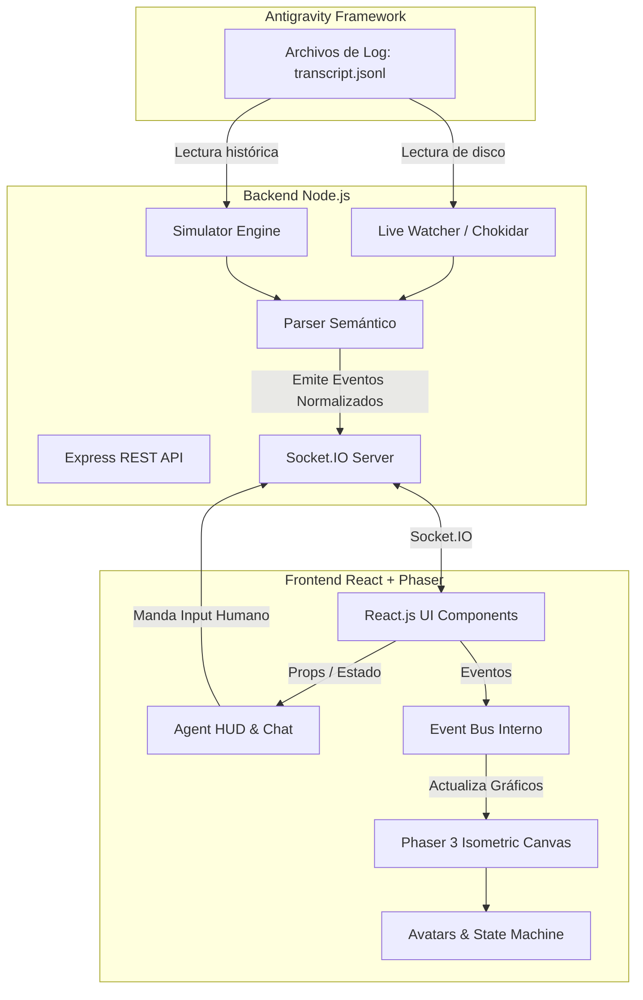

# Documentación Técnica y de Arquitectura

## 1. Arquitectura del Sistema

El proyecto implementa una arquitectura desacoplada Cliente-Servidor impulsada por eventos (Event-Driven Architecture) utilizando **WebSockets**.

### Diagrama de Flujo (Mermaid)



## 2. Flujo de Datos y Telemetría

El backend parsea archivos `.jsonl` y genera "Eventos de Telemetría" estandarizados. 
Estos eventos son consumidos por el cliente para animar la Módulo de Renderizado Isométrico.

### Estructura del Evento de Telemetría (Payload)

```json
{
  "eventId": "uuid-v4",
  "timestamp": "2026-10-10T23:45:00Z",
  "agentId": "conversation-uuid-1234",
  "agentRole": "senior_developer",
  "state": "WORKING",
  "metadata": {
    "toolInUse": "write_to_file",
    "thought": "Necesito modificar el archivo README.md"
  }
}
```

## 3. Especificación de Endpoints y APIs (OpenAPI)

El backend de Node.js provee una REST API sencilla para el control del motor de reproducción, y una conexión persistente por WebSockets para los eventos.

### REST API

#### `GET /api/sessions`
Obtiene las carpetas disponibles en el directorio del orquestador.
* **Respuestas:**
  * `200 OK`: Lista de sesiones.
  ```json
  {
    "sessions": [
      { "id": "uuid-1", "date": "2026-10-09", "name": "EPIC-004 Orchestration" }
    ]
  }
  ```

#### `POST /api/sessions/select`
Carga una sesión en la memoria del backend.
* **Cuerpo de Petición:**
  ```json
  { "sessionId": "uuid-1", "mode": "simulation", "speed": 5 }
  ```
* **Respuestas:**
  * `200 OK`: `{"status": "Session loaded and running"}`
  * `400 Bad Request`: Parámetros inválidos.

### Eventos WebSocket (Socket.IO)

* **Servidor ➔ Cliente (`AGENT_EVENT`):** Notifica los cambios de estado de un avatar.
* **Servidor ➔ Cliente (`SESSION_CHANGED`):** Ordena la destrucción de los avatares actuales y limpia el canvas.
* **Cliente ➔ Servidor (`USER_RESPONSE_INPUT`):** Envía el input introducido por el humano en la UI de React.

## 4. Decisiones de Diseño Arquitectónico (ADRs)

1. **Desacoplamiento UI-Motor Gráfico (EventBus):** 
   * **Problema:** React re-renderiza frecuentemente. Phaser mantiene un loop `update()` a 60FPS. Mezclar el estado de React con los GameObjects de Phaser genera memory leaks y bajones severos de rendimiento.
   * **Solución:** Se implementó el patrón `EventBus` (`frontend/src/game/eventBus.js`). Socket.IO actualiza React, y React se comunica con la escena isométrica enviando eventos serializados (`EventBus.emit('SPAWN', data)`). El motor de juegos se mantiene agnóstico del estado de React.

2. **Detección Recursiva de Subagentes:**
   * **Problema:** El sistema multi-agente generaba los subagentes en carpetas aleatorias no vinculadas explícitamente en la raíz de la telemetría principal.
   * **Solución:** El `parser.js` se engancha interceptando el log exacto `"Created the following subagents:"`, extrae las rutas absolutas y añade automáticamente nuevos `watchers` recursivos, centralizando la data en una misma cola temporal (`eventsQueue`).

